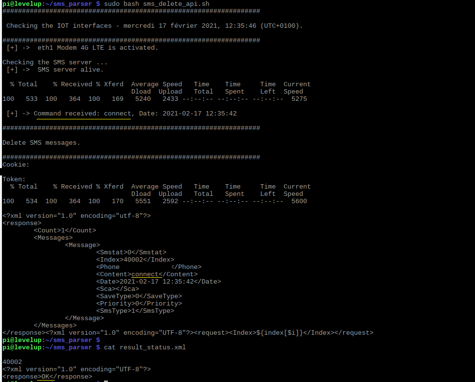
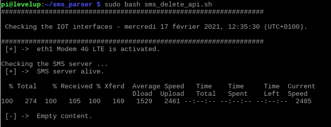

# SMS Parser — Remote Control of IoT Devices via a 4G Modem

A Bash tool that turns SMS messages into **remote commands** for Linux IoT devices. It uses the XML web API of a **Huawei E3372 4G LTE USB modem** to read the latest SMS, run the matching command, then delete the processed messages from the modem.

## How It Works

1. **Interface check**: detects which network interfaces are active from the routing table: `eth0` (LAN), `wlan0` (Wi-Fi), `eth1` (4G LTE modem).
2. **Session**: requests a session cookie and a CSRF token from the modem (`/api/webserver/SesTokInfo`).
3. **Read**: fetches the latest SMS from the inbox (`/api/sms/sms-list`) and extracts its content and date with `xmlstarlet`.
4. **Dispatch**: matches the SMS text against the supported commands.
5. **Clean up**: lists every SMS index and deletes each message (`/api/sms/delete-sms`), so the next command starts from an empty inbox.

## Supported Commands

| SMS text | Action |
|----------|--------|
| `connect` | Connect the device |
| `disconnect` | Disconnect the device |
| `update` | Trigger an update |
| *(anything else)* | Reported as unknown |

New commands are added in the `if / elif` block of the script.

## Screenshots

**Command received and SMS deleted**



**Empty inbox**



## Repository Structure

```
.
├── src/
│   └── sms_parser.sh        # Main script
├── examples/
│   ├── modem_status.xml     # Sample sms-list API response
│   └── result_status.xml    # Sample delete-sms API response
├── logs/
│   └── output_result_delete_SMS_message.txt   # Example run
└── photos/                  # Screenshots
```

## Requirements

- Huawei E3372 (HiLink mode) or a compatible modem with the same web API
- Linux with `bash`, `curl` and `xmlstarlet`

```bash
sudo apt install curl xmlstarlet
```

## Usage

```bash
# Set the modem address at the top of the script (default: 192.168.8.1)
sudo bash src/sms_parser.sh
```

To poll for new commands regularly, run it from `cron`:

```bash
* * * * * /bin/bash /path/to/src/sms_parser.sh >> /var/log/sms_parser.log 2>&1
```

## Tech Stack

Bash · curl · xmlstarlet · Huawei HiLink XML API · 4G LTE · Linux / Raspberry Pi

## Author

**Akram M'Tir**, [@amtir](https://github.com/amtir)
